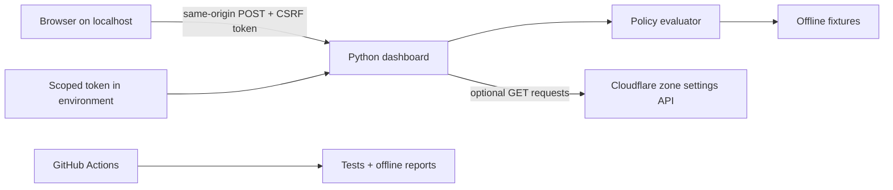

# Case study: Cloudflare Baseline Guard

## Problem

A team can enable Cloudflare but still leave individual controls inconsistent. Reviewers need a repeatable way to see which settings match a chosen security baseline and why a DDoS design needs more than an on/off switch.

## Goal and scope

Build a small, low-cost DevSecOps portfolio project using Python, GitHub Actions, and Cloudflare APIs. The deliverable is a local dashboard, a CLI, offline demonstration data, automated tests, and a read-only live audit path. No real domain is needed for the demonstration.

## Architecture

The local server binds to `127.0.0.1`. The Cloudflare token stays in the server environment. The browser receives findings, never the token. Live mode performs four GET requests with `Zone Settings Read` permission and never updates a zone.

## Security decisions

| Decision | Reason | Evidence |
|---|---|---|
| Fail closed for missing or malformed settings | An incomplete API response must not look compliant | Unit tests and exit code 2 |
| No live credentials in PR CI | Pull request code must not receive the token | Fixture-only `verify` job |
| Manual opt-in live job | Prevent an unconfigured manual run from failing the portfolio pipeline | `workflow_dispatch` boolean input |
| Local-only UI with Host, Origin and CSRF checks | Avoid accidental cross-site use of the local audit endpoint | HTTP integration test |
| Bound local work | Limit accidental overload of the small process | Body cap, socket timeout, rate limit, two audit slots |

## DDoS design

The DDoS page is an **architecture exercise**. It checks five assertions in sample profiles: zone activation, proxied web DNS, origin isolation, edge mitigation, and a sensitive-path rate limit. A passing sample does not prove a real site is protected. For a deployed site, evidence must come from Cloudflare settings, DNS, origin firewall/Tunnel configuration, and normal-traffic tests. See [DDOS.md](DDOS.md).

## Validation

Run `PYTHONPATH=src python3 -m unittest discover -s tests -v` for unit and HTTP integration tests. Run `PYTHONPATH=src python3 -m cfguard.demo --output demo-reports` to produce four deterministic reports. The CI workflow repeats these steps and uploads the reports as a build artifact.

## Outcome and limits

The project provides a reproducible local demonstration with no cloud charges. It does not run a live DDoS test or inspect a real zone in the offline demo. The live API path covers only four TLS/HTTPS settings; DNS, WAF, origin firewall, and rate limit status remain manual evidence items until a real zone is available.
