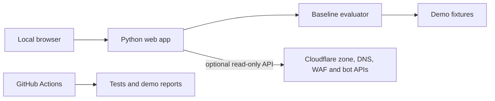

# Cloudflare Baseline Guard

A local web app and CLI for read-only DevSecOps audits of Cloudflare TLS/HTTPS settings and DDoS posture. It runs with sample data or a real zone and scoped API token. GitHub Actions verifies the offline scenarios and can run both live audits on demand.

## Architecture



The [case study](CASE_STUDY.md) explains the design, security decisions, validation, and limits. [DEMO.md](DEMO.md) gives a reproducible three-minute walkthrough.

The [public Cloudflare Pages demo](https://cloudflare-baseline-guard.pages.dev/) serves the `site/` directory with four precomputed fixture reports. It contains no API token or live audit endpoint. The real-zone auditor remains in the local app and CLI.

## Run the app

Requires Python 3.10+; no third-party packages. From the project directory:

```sh
PYTHONPATH=src python3 -m cfguard.web
```

Open **http://127.0.0.1:8765** in your browser. Click **Показать проблемы** or **Безопасный пример** to try the demo. The dashboard shows each finding and lets you download a Markdown report. Stop the app with `Ctrl+C`.

The **DDoS readiness** buttons include two educational profiles and a live read-only zone audit. See [DDOS.md](DDOS.md) for what the audit can verify and what requires manual evidence.

On macOS, you can also run `start.command` from the extracted project folder; it starts the local server and opens the browser. Keep the Terminal window open while using the app.

The server binds to `127.0.0.1` only, validates the browser origin and request token, and keeps the API token on the server. It is designed for local use, not public hosting.

## What it checks

| Setting | Expected | Why |
|---|---|---|
| `always_use_https` | `on` | Redirect visitors to HTTPS |
| `ssl` | `strict` | Validate TLS between Cloudflare and the origin |
| `min_tls_version` | `1.2` or newer | Reject older TLS versions |
| `tls_1_3` | `on` | Enable TLS 1.3 without 0-RTT |

This is an **opinionated baseline**, not a certificate of security. In particular, `tls_1_3=zrt` is reported as a failure because this baseline excludes 0-RTT. Review compatibility and origin configuration before changing production settings. The tool never changes settings.

## CLI and tests

```sh
PYTHONPATH=src python -m cfguard --fixture fixtures/secure.json --report report.md
PYTHONPATH=src python -m cfguard --fixture fixtures/insecure.json
PYTHONPATH=src python -m unittest discover -s tests -v
PYTHONPATH=src python -m cfguard.demo --output demo-reports
```

Exit codes: `0` all checks pass, `1` at least one check fails, `2` input/API error. Missing settings fail closed.

## Audit your Cloudflare zone

Create an API token scoped to one zone with **Zone Read**, **Zone Settings Read**, **DNS Read**, **Zone WAF Read**, and **Bot Management Read** permissions. Do not use a Global API Key. Set it in your shell, along with the zone ID, then run:

```sh
export CF_API_TOKEN='your-token'
export CF_ZONE_ID='your-zone-id'
PYTHONPATH=src python -m cfguard --zone-id "$CF_ZONE_ID" --report report.md
```

To enable **Моя зона** and **Проверить мою зону** in the web app, set `CF_API_TOKEN` and `CF_ZONE_ID` in the shell before starting the server. For the DDoS audit, set optional `CF_HOSTNAMES=example.com,www.example.com`; otherwise it checks the zone apex. The values are not entered in the browser. See [DOMAIN_SETUP.md](DOMAIN_SETUP.md) if you do not yet have a zone.

For GitHub Actions, add `CF_API_TOKEN` and `CF_ZONE_ID` as secrets on the `cloudflare-audit` environment, then start **Security baseline CI** with `workflow_dispatch` and select `live`. The push/PR job uses fixtures only. Restrict environment access in a shared repository. Live reports are not uploaded as public artifacts; run locally when you need to retain them.

## Portfolio demonstration

Follow [DEMO.md](DEMO.md) to show all four scenarios and generate reports without cloud credentials. The `verify` CI job runs without secrets; the live job runs both read-only audits only when its boolean input is selected and the `cloudflare-audit` environment is configured. No real zone is connected yet, so production API behavior has not been validated.

See [SECURITY.md](SECURITY.md) for the threat model, [DDOS.md](DDOS.md) for the DDoS audit, and [DOMAIN_SETUP.md](DOMAIN_SETUP.md) for connecting a domain.

## References

- [Cloudflare API: Get zone setting](https://developers.cloudflare.com/api/resources/zones/subresources/settings/methods/get/)
- [Cloudflare API: Zone setting values](https://developers.cloudflare.com/api/resources/zones/subresources/settings/)
